# Cloud Lab 2 Submission — Load Balancer and Auto Scaling

Copy this template to `cc-lab-YOUR_ID/lab2/README.md` in your own repository. Follow [the instructions](lab2-instruction.md). Put your screenshots in `lab2/images/` with the file names below.

- **Student name:** CHEANG Seyha
- **Student ID:** e20221098
- **Learner Lab user name:** Seyha
- **Date completed:** 5 Nov 2026

---

## Security groups

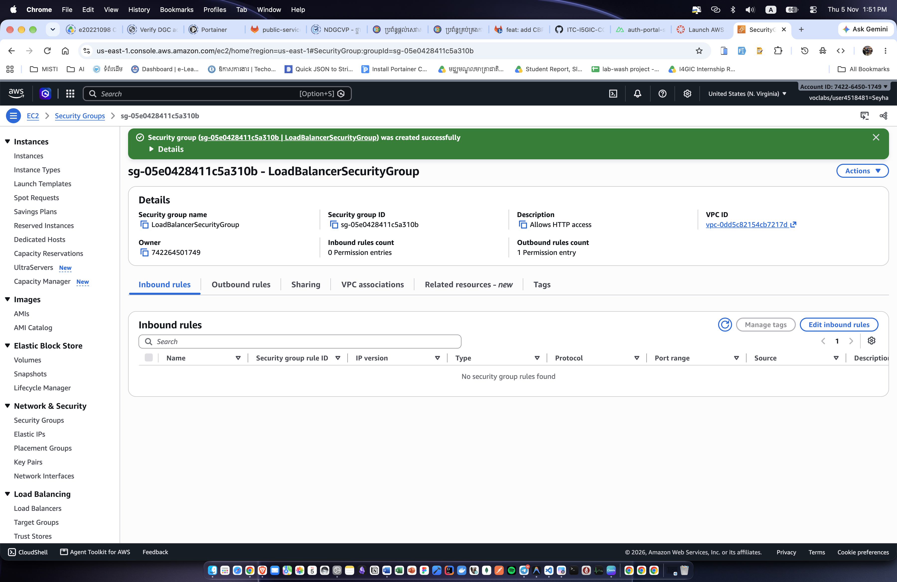

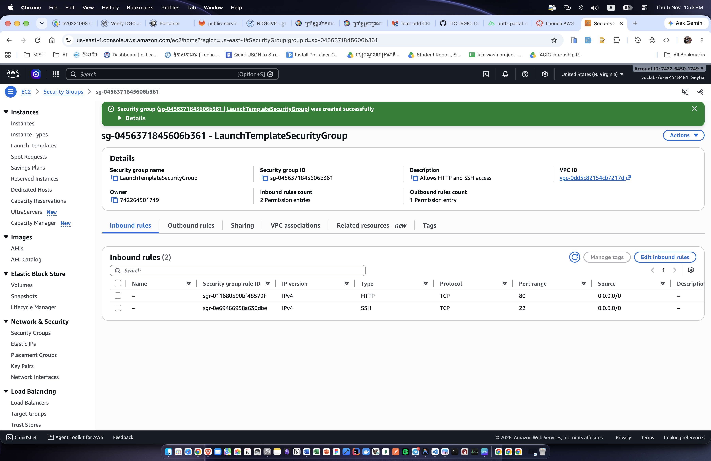

## Target group

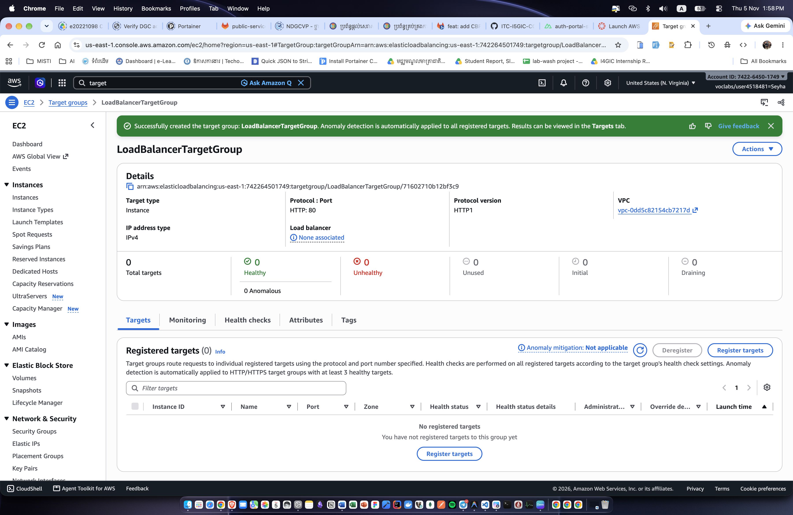

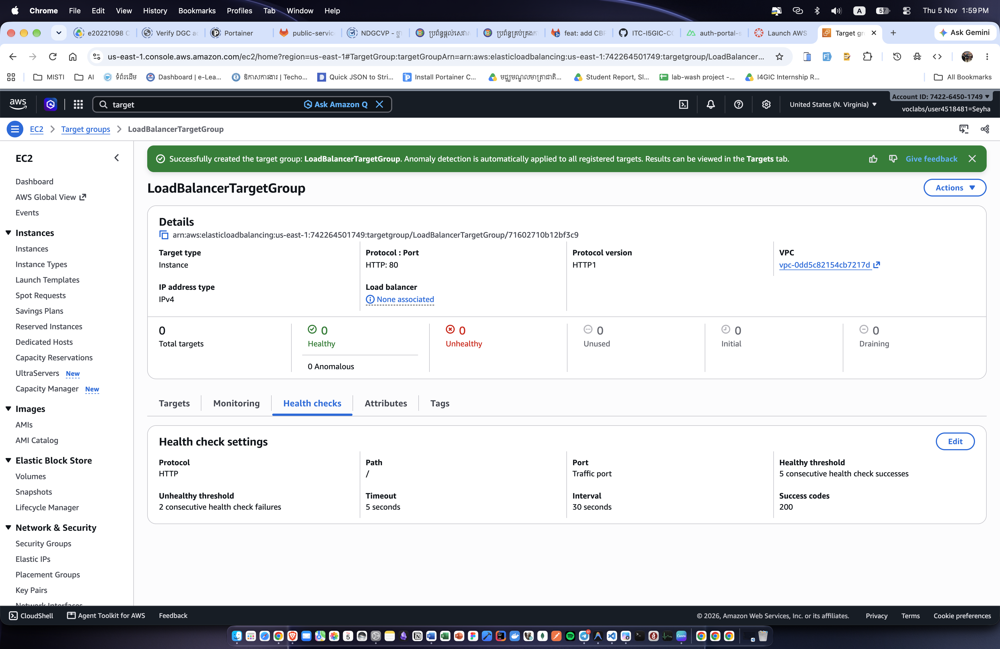

## Application Load Balancer

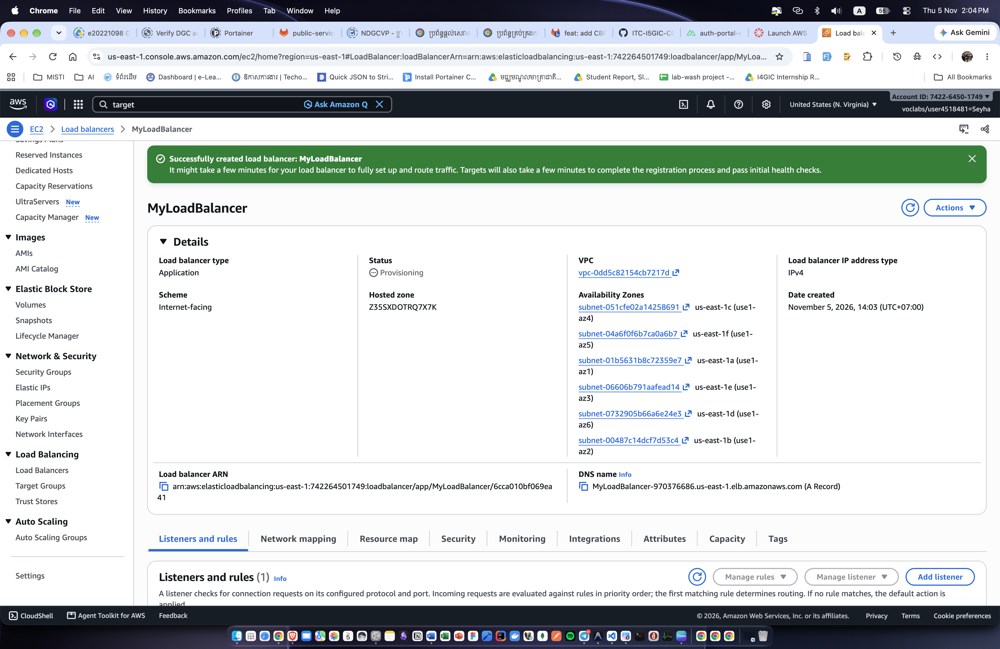

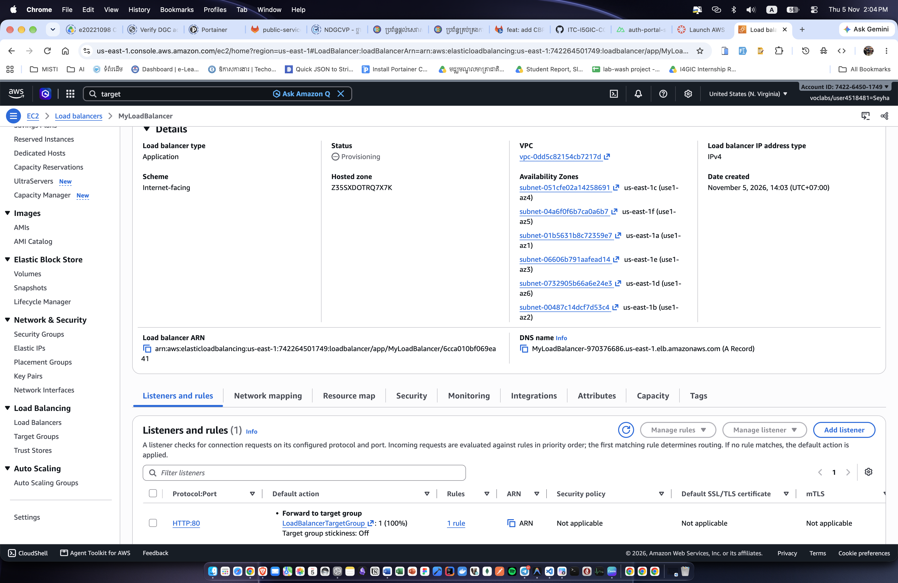

## Launch template

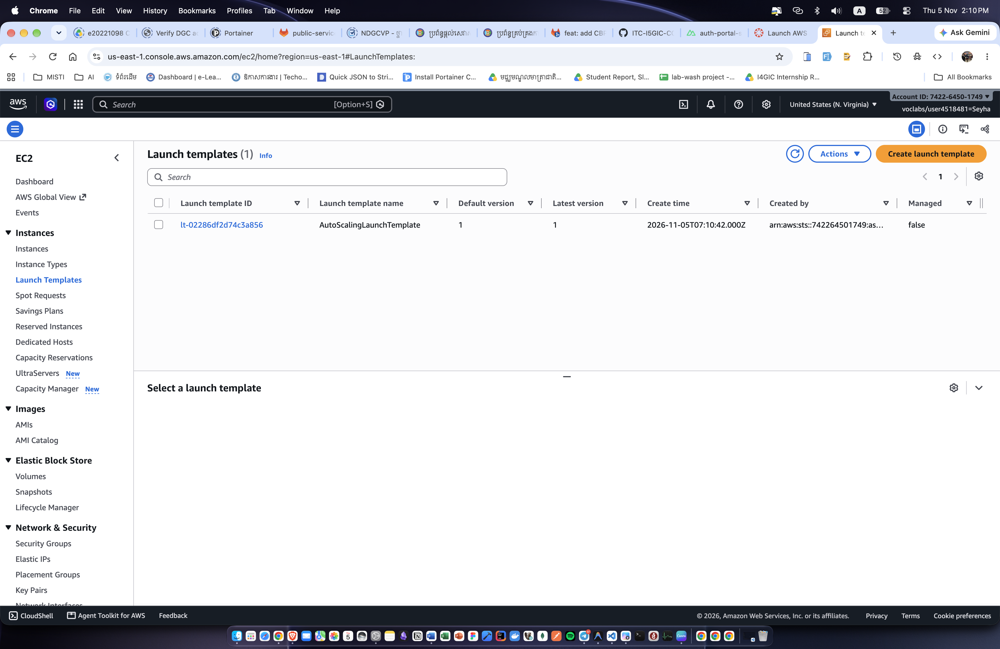

## Auto Scaling group

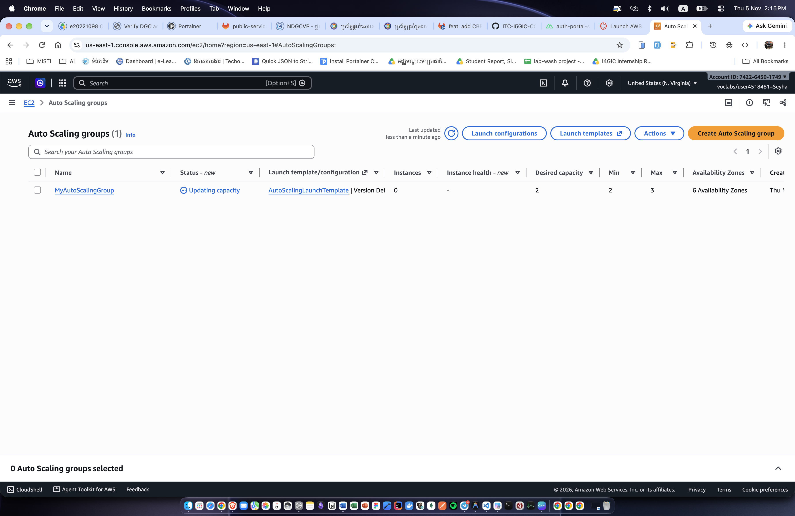

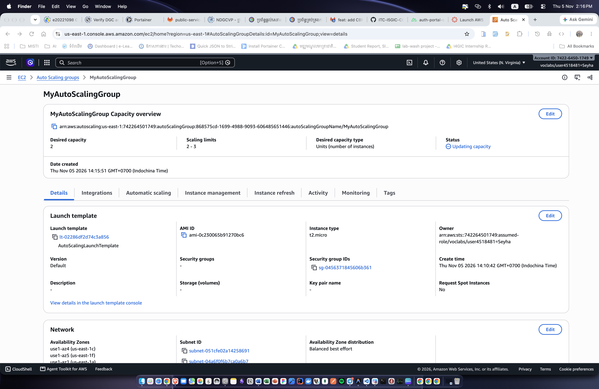

## Load balancing test

## Simulated application failure

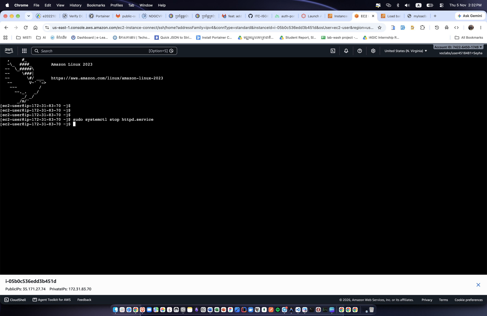

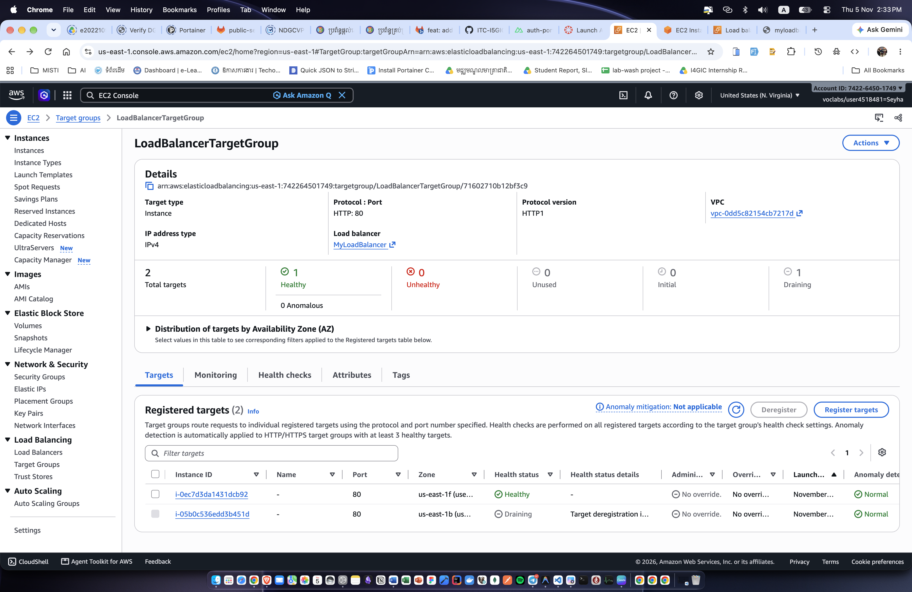

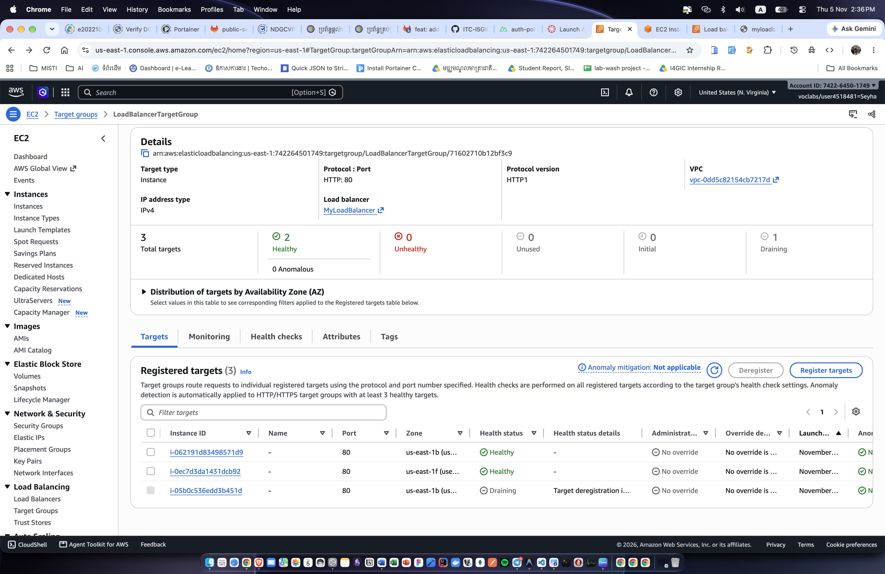

About how many minutes passed between stopping `httpd` and the new instance becoming healthy?

**Answer:** About **4 minutes** passed (stopped at 2:32 PM, target group marked draining/unhealthy at 2:33 PM, and the replacement target reached healthy status at 2:36 PM).

---

## Questions

1. Why does the page show a different host name when you refresh it?
   - The Application Load Balancer (ALB) distributes incoming HTTP requests across all healthy targets registered in the target group using a round-robin routing algorithm. Because there are two healthy EC2 instances running (`ip-172-31-83-70` and `ip-172-31-66-197`), refreshing the page routes the request to a different backend server, which outputs its own private hostname.

2. After you stopped `httpd`, the instance was still *running* in EC2, but the target group marked it *unhealthy*. What did the health check test, and why did the instance fail it?
   - **What it tested:** The target group health check performs application-layer checks by sending HTTP GET requests to path `/` on port 80 at 30-second intervals, expecting an HTTP `200` status code response within a 5-second timeout.
   - **Why it failed:** While the EC2 virtual machine and OS were still running (passing hypervisor/hardware status checks), stopping the `httpd` web server service meant nothing was listening on port 80. Connection attempts failed or timed out, returning no HTTP 200 response. After reaching the unhealthy threshold (2 consecutive failures), the target group marked the target instance as unhealthy/draining.

3. Who replaced the failed instance: the load balancer, the target group, or the Auto Scaling group? Explain the role of each one.
   - **The Auto Scaling group (ASG)** replaced the failed instance.
   - **Roles of each component:**
     - **Load Balancer:** Routes incoming user traffic only to healthy targets. When a target becomes unhealthy, the load balancer stops directing new traffic to it and drains existing connections. The load balancer cannot launch or terminate EC2 instances.
     - **Target Group:** Continuously evaluates the health of registered targets via health check probes and reports their status (Healthy, Unhealthy, Draining) to the load balancer and Auto Scaling group.
     - **Auto Scaling Group:** Maintains the desired instance capacity (2 instances). When notified that an instance is unhealthy, the ASG terminates the failed instance and launches a new EC2 instance using the launch template to maintain desired capacity.

4. With desired 2, minimum 2 and maximum 3, how many instances run normally? In what situation could there be 3?
   - **Normally running:** Exactly **2 instances** run normally because the desired capacity is set to 2.
   - **Situation with 3 instances:** A 3rd instance can run if:
     - A dynamic or scheduled scaling policy triggers due to increased load (e.g., high CPU utilization or high request count) scaling the group up to the maximum capacity of 3.
     - During an instance replacement lifecycle when a new replacement instance is launched while the unhealthy instance is still terminating/draining, or if desired capacity is manually increased to 3.

5. The instances' security group allows HTTP from anywhere. How could you change it so that the instances accept HTTP **only** from the load balancer?
   - In the inbound rules of the instances' security group (`LaunchTemplateSecurityGroup`), edit the rule for HTTP (TCP port 80):
     - Change the **Source** from `0.0.0.0/0` (Anywhere) to the **Security Group ID** of the Application Load Balancer (`LoadBalancerSecurityGroup` / `sg-05e0428411c5a310b`).
     - This security group reference restricts port 80 access so only packets originating from the load balancer are accepted, preventing direct public access to the instances.

## Problems and how I solved them (optional)

- Ensuring the target group health check parameters and deregistration delay gave sufficient time to observe the unhealthy/draining transition without immediately losing connection to the instance.

## AI note (optional)

One suggestion an AI tool gave you and how you checked it.
- An AI tool suggested referencing the security group ID directly as the source in another security group rather than IP CIDR blocks to restrict traffic exclusively to the Application Load Balancer. I checked this in the AWS EC2 Security Groups console by editing the inbound rules of `LaunchTemplateSecurityGroup`, entering the ID `sg-05e0428411c5a310b` in the Source field, and verifying AWS accepted the security group reference.

## Clean up

- [x] `MyAutoScalingGroup` deleted and its instances terminated.
- [x] `AutoScalingLaunchTemplate` deleted.
- [x] `MyLoadBalancer` and `LoadBalancerTargetGroup` deleted.
- [x] Both security groups deleted.
