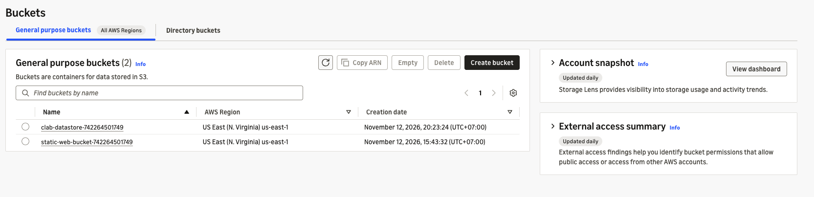
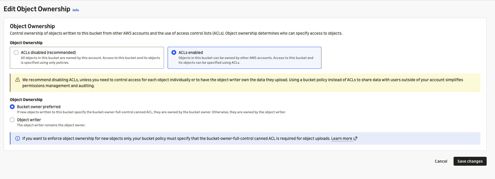
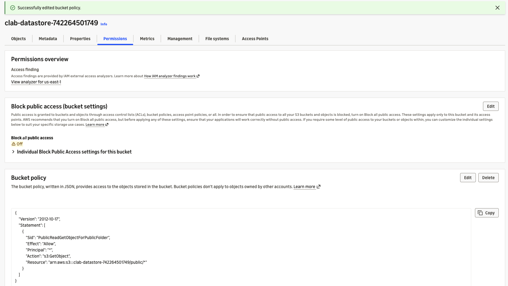
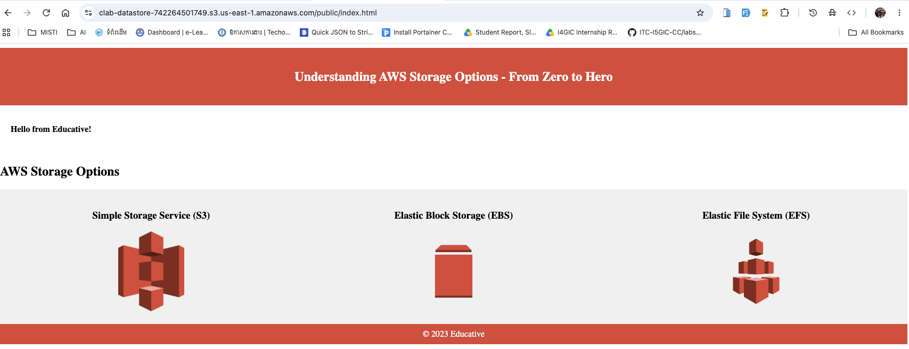
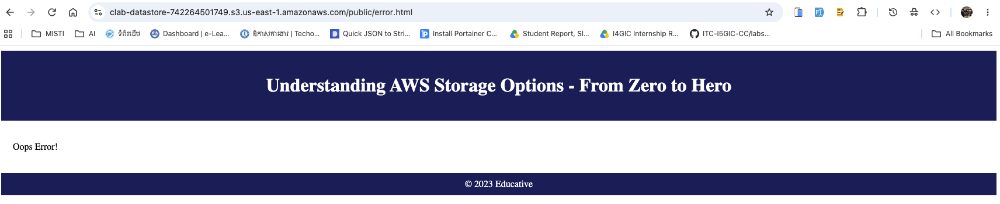
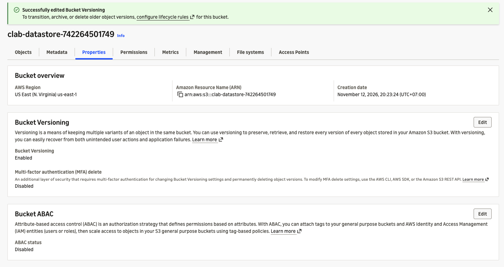
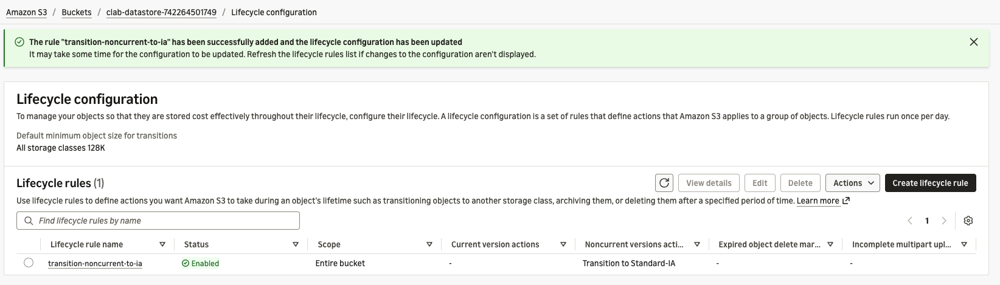

# Cloud Lab 3 Challenge Submission — Secure S3 Bucket

Copy this template to `cc-lab-YOUR_ID/lab3-challenge/README.md` in your own repository. Follow [the challenge](lab3-challenge.md). Put your screenshots in `lab3-challenge/images/` and your policy in `lab3-challenge/bucket-policy.json`.

- **Student name:** CHEANG Seyha
- **Student ID:** e20221098
- **Learner Lab user name:** Seyha
- **Bucket name:** clab-datastore-742264501749
- **Date completed:** 12 Nov 2026

---

## 1. Bucket



## 2. Object ownership



## 3. Public access policy







My policy is in [bucket-policy.json](bucket-policy.json). Explain which line limits public access to the `public/` folder:

```json
"Resource": "arn:aws:s3:::clab-datastore-742264501749/public/*"
```

**Explanation:**
The `"Resource"` line defines the exact Amazon Resource Name (ARN) scope of the `Allow` statement. By specifying the key prefix `public/*` after the bucket ARN (`arn:aws:s3:::clab-datastore-742264501749`), the policy restricts the public `s3:GetObject` permission strictly to objects stored inside the `public/` folder. Any objects stored outside this path (such as at the root level or in other folders) do not match this resource pattern and remain protected by S3's default deny rule.

## 4. Versioning



## 5. Lifecycle rule



---

## Questions

1. You turned off parts of **Block Public Access** for this bucket. Why was that needed, and why is it still safe for the objects outside `public/`?
   - **Why it was needed:** Amazon S3's "Block Public Access" (BPA) includes safeguards that prevent the application of any bucket policy granting access to anonymous or public users (`"Principal": "*"`). If BPA remained fully turned on, AWS would reject the bucket policy with an access denied error. Disabling the relevant BPA settings is required so the bucket policy can be applied and enforced.
   - **Why it is still safe for objects outside `public/`:** Turning off Block Public Access does not automatically make the bucket contents public; it simply allows policy-based public access rules to take effect. S3 permissions operate on a default-deny model. Because our bucket policy explicitly restricts public `s3:GetObject` permissions solely to the resource ARN `"arn:aws:s3:::clab-datastore-742264501749/public/*"`, any objects residing outside the `public/` folder lack an explicit allow statement for the public principal. Consequently, they remain entirely private and inaccessible to unauthorized users.

2. What is a **noncurrent version**? Give an example from your own test.
   - **What it is:** When S3 Bucket Versioning is enabled, modifying or replacing an existing object does not overwrite the old data. Instead, S3 creates a new variant with a new unique Version ID, designating it as the **current version** (the version retrieved by default requests). The previous version is retained in the bucket with its original Version ID and becomes a **noncurrent version**.
   - **Example from test:** When uploading the initial version of `index.html` to `public/index.html`, it was saved with a unique version ID as the active, current version. Upon uploading an updated `index.html` with modifications to the same path, S3 preserved the earlier upload with its original timestamp and version ID as a *noncurrent version*, while the newly uploaded file became the *current version*.

3. Why move noncurrent versions to S3 Standard-IA instead of deleting them?
   - **Cost savings:** S3 Standard-Infrequent Access (Standard-IA) offers a lower per-gigabyte storage cost (roughly 40%–50% cheaper than S3 Standard) while retaining the exact same high durability (99.999999999%) and rapid millisecond retrieval latency.
   - **Data protection and disaster recovery:** Older versions are seldom accessed during regular application workflows, but permanently deleting them would eliminate version history. Retaining noncurrent versions in Standard-IA ensures that previous states of files remain fully recoverable in cases of accidental overwrites, inadvertent deletions, or administrative rollbacks, while keeping ongoing storage costs to a minimum.

## AI note (optional)

One suggestion an AI tool gave you and how you checked it.
- **AI suggestion:** When crafting the S3 bucket policy to restrict anonymous read access exclusively to a subfolder, an AI tool recommended ensuring that the trailing wildcard `/*` is attached to the prefix (i.e. `public/*` rather than `public`), because S3 object keys evaluate folder paths as string prefixes.
- **How I checked it:** I tested this by checking AWS S3 documentation on ARN formats and validating that requests to `https://clab-datastore-742264501749.s3.us-east-1.amazonaws.com/public/index.html` succeeded with HTTP 200, whereas requests outside the `public/` prefix were denied.

## Clean up

- [x] All object versions deleted and the bucket deleted.
