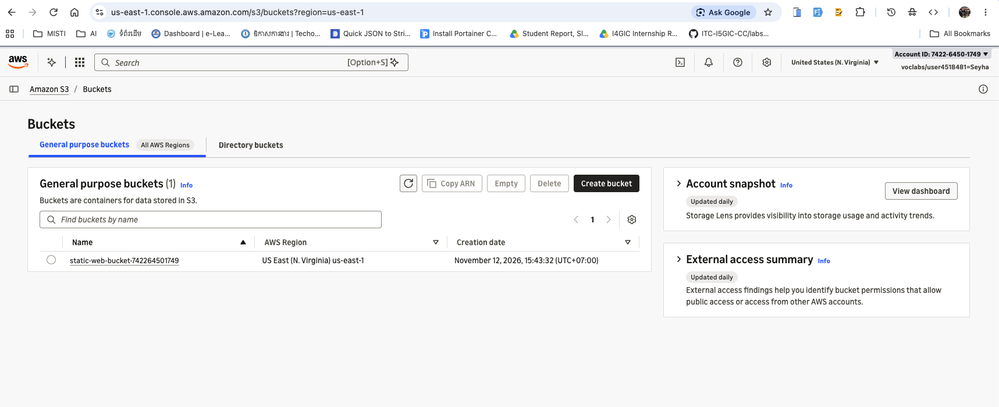
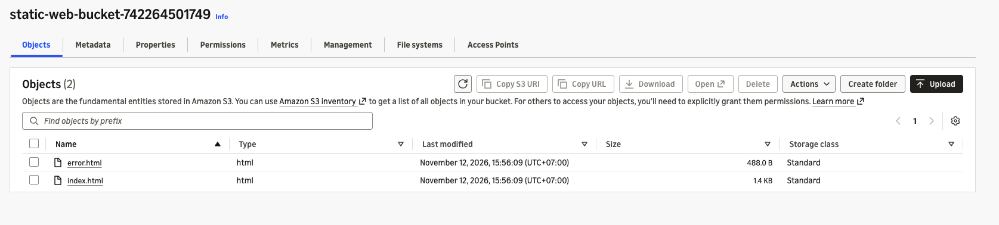
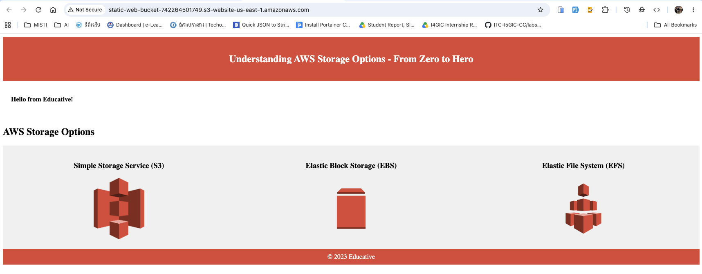
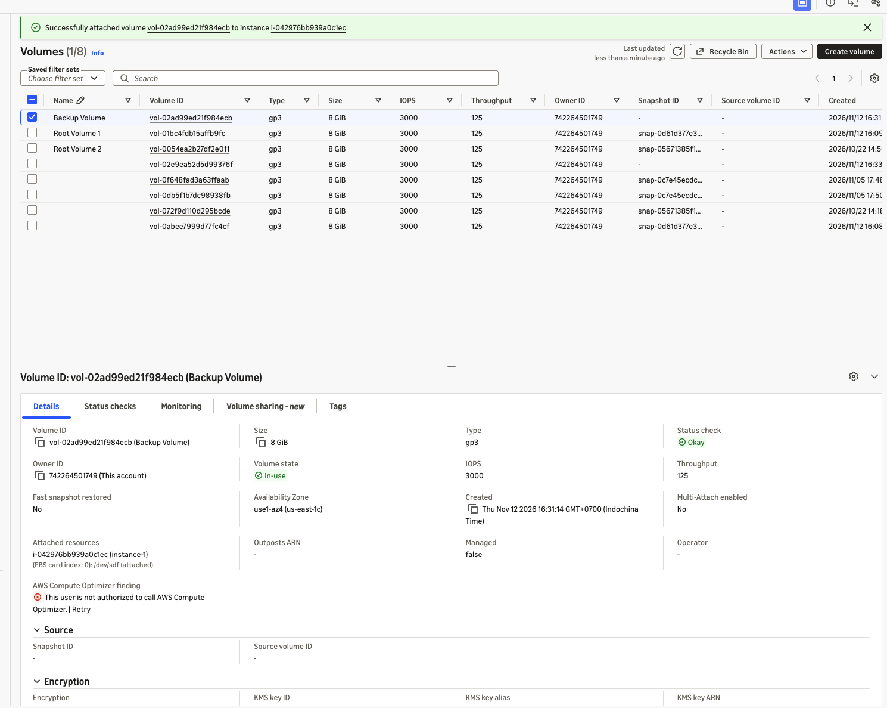
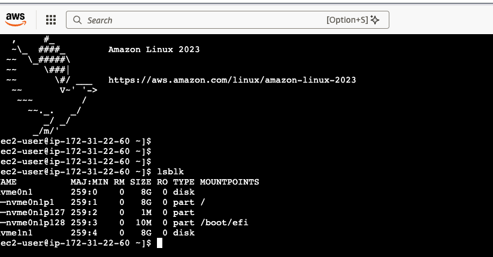
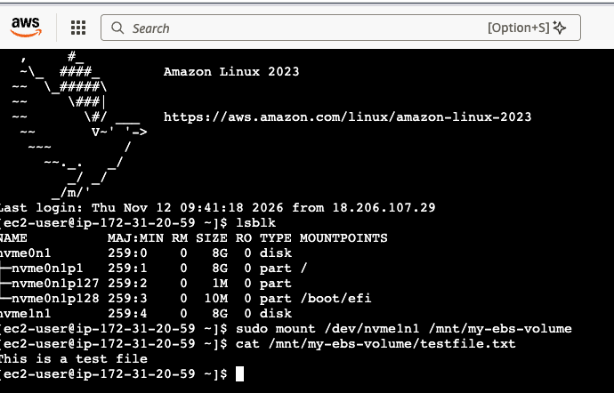
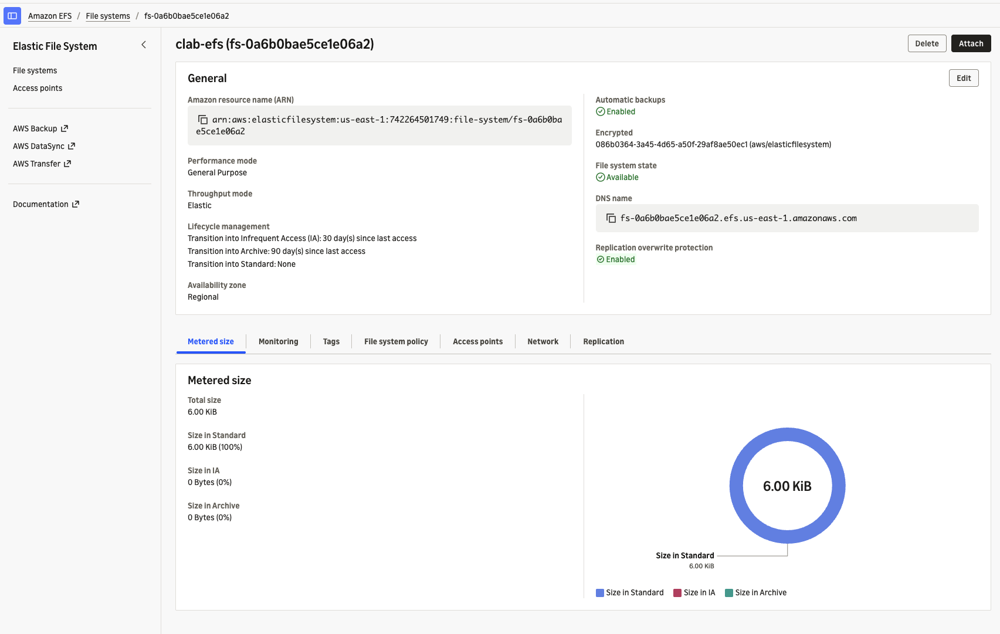
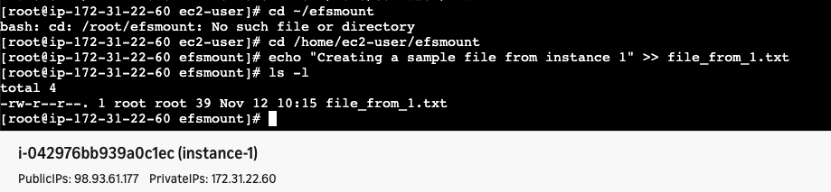
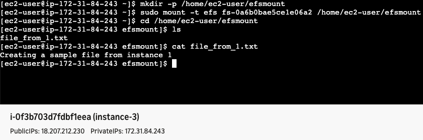

# Cloud Lab 3 Submission — AWS Storage Options

Copy this template to `cc-lab-YOUR_ID/lab3/README.md` in your own repository. Follow [the instructions](lab3-instruction.md). Put your screenshots in `lab3/images/` with the file names below.

- **Student name:** CHEANG Seyha
- **Student ID:** e20221098
- **Learner Lab user name:** Seyha
- **Date completed:** 12 Nov 2026

---

## Part 2.1 — Amazon S3

### Bucket list

### Uploaded files

### Static website

---

## Part 2.2 — Amazon EBS

### Volumes page

### Attached volume (`lsblk`)

Which device name did your volume get (`xvdf`, `nvme1n1`, ...)?

**Device name:** `nvme1n1` (attached in the AWS Management Console as `/dev/sdf`, but recognized on modern Nitro-based Amazon Linux 2023 instances as `/dev/nvme1n1`).

### File read on instance-2

---

## Part 2.3 — Amazon EFS

### File system and mount targets

### File created on instance-1

### File listed on instance-3

---

## Questions

1. After you turned on static website hosting, the endpoint first answered **403 Forbidden**. Why, and what changed after you added the bucket policy?
   - **Why it answered 403 Forbidden:** By default, Amazon S3 buckets are private and have "Block Public Access" enabled to protect against unintended exposure. Enabling static website hosting merely activates the web server endpoint routing (serving `index.html` as the index document and `error.html` for errors), but does **not** grant public read permissions to the files stored inside the bucket. Because anonymous public users lacked read permissions, any GET request returned `403 Forbidden`.
   - **What changed after adding the bucket policy:** After turning off the Block Public Access setting that blocked public policies, we added a bucket policy explicitly granting `s3:GetObject` permission to all principals (`*`) across the bucket objects (`arn:aws:s3:::static-web-bucket-742264501749/*`). This granted anonymous HTTP clients public read access, allowing the website endpoint to retrieve and serve `index.html` with an HTTP `200 OK` response.

2. `testfile.txt` was still there after you moved **Backup Volume** to `instance-2`. What would have happened to a file saved on `instance-1`'s **root** volume after terminating `instance-1`?
   - A file saved on `instance-1`'s **root** volume would have been **permanently deleted**.
   - By default, an EC2 instance's root EBS volume has the `DeleteOnTermination` attribute enabled (`true`). When `instance-1` is terminated, AWS automatically deletes its attached root volume along with all stored data.
   - In contrast, the **Backup Volume** was an attached secondary EBS volume created independently. Secondary EBS volumes persist separately from the instance lifecycle (with `DeleteOnTermination` defaulting to `false`). Consequently, when detached from `instance-1` and reattached to `instance-2`, the volume and the file `testfile.txt` remained completely preserved.

3. Why did you run `mkfs` on `instance-1` but not on `instance-2`?
   - The command `mkfs` (make filesystem) initializes and creates a new filesystem structure (inodes, superblock, directory tables) on a raw block storage device.
   - On **`instance-1`**, the newly created EBS volume was raw, unformatted storage. The operating system cannot store files or mount a disk without an existing filesystem, so `mkfs` had to be executed to format the disk (e.g., ext4) prior to mounting.
   - On **`instance-2`**, the filesystem and its data (`testfile.txt`) had already been created during the initial setup on `instance-1`. If `mkfs` had been run on `instance-2`, it would have formatted the device again, erasing the entire filesystem structure and permanently deleting `testfile.txt`. Therefore, `instance-2` only needed to mount the existing filesystem directly using `sudo mount`.

4. Why could `instance-1` and `instance-3` use the EFS file system at the same time, when an EBS volume had to be detached first? Why did they have to be in the subnets of the mount targets?
   - **Why EFS allows simultaneous access while EBS does not:**
     - **Amazon EFS** is a managed network-attached file system using the NFSv4 protocol. It is specifically designed as distributed, shared storage supporting concurrent multi-instance read and write operations across hundreds of instances with POSIX-compliant distributed file locking.
     - **Standard Amazon EBS** volumes are block-level storage devices intended for 1-to-1 attachment to a single EC2 instance at a time. Standard filesystems (such as ext4 or XFS) are not cluster-aware; if multiple instances mount and write to the same block device simultaneously without cluster coordination, filesystem corruption occurs. Thus, EBS volumes must be cleanly unmounted and detached before moving to another instance.
   - **Why instances must be in the subnets of the mount targets:**
     - EFS mount targets provide an NFS endpoint (an Elastic Network Interface / ENI with a private IP address) within a specific VPC subnet / Availability Zone.
     - For EC2 instances to connect to the EFS file system over NFS (TCP port 2049), network traffic routes directly through the mount target in that subnet/AZ. Being located in the mount target subnets ensures direct, low-latency local routing within the VPC and allows the mount target security group (`efs-sg`) to evaluate and permit incoming NFS traffic from the instances' security group (`ec2instances-sg`).

5. For each need, choose S3, EBS or EFS and give one reason: (a) a website's images, (b) the disk of a database server, (c) a folder shared by several web servers.
   - **(a) A website's images: Amazon S3 (Simple Storage Service)**
     - *Reason:* S3 is highly scalable, cost-effective object storage designed for storing static assets and serving them directly over HTTP/HTTPS with high durability (99.999999999%), without requiring server compute overhead or filesystem maintenance.
   - **(b) The disk of a database server: Amazon EBS (Elastic Block Storage)**
     - *Reason:* Relational and NoSQL database management systems require dedicated, low-latency (single-digit millisecond or sub-millisecond) block-level storage with high IOPS and throughput for database files and transaction write-ahead logs.
   - **(c) A folder shared by several web servers: Amazon EFS (Elastic File System)**
     - *Reason:* EFS is a managed shared file system that natively supports simultaneous multi-attach read/write operations from multiple EC2 instances across multiple Availability Zones using standard POSIX/NFS semantics.

## Problems and how I solved them (optional)

- **EBS Block Device Mapping on Amazon Linux 2023:** In the AWS Management Console, the volume was attached to `instance-1` as `/dev/sdf`. However, running `lsblk` showed that Nitro-based instances expose EBS volumes as NVMe block devices (`/dev/nvme1n1`). I resolved this by inspecting `lsblk` and using `/dev/nvme1n1` for formatting (`mkfs`) and mounting.
- **EFS Mount Directory Path Navigation:** While creating `file_from_1.txt` as the `root` user, running `cd ~/efsmount` returned `No such file or directory` because the mount directory had been created in `/home/ec2-user/efsmount`. I resolved this by explicitly targeting `/home/ec2-user/efsmount`.
- **Resolving 403 Forbidden on S3 Static Website:** Enabling static website hosting returned a 403 Forbidden error until I updated the bucket permissions by disabling "Block all public access" and attaching a bucket policy that allows `s3:GetObject` for all principals (`*`).

## AI note (optional)

One suggestion an AI tool gave you and how you checked it.
- **AI suggestion:** An AI tool suggested using the Amazon EFS mount helper package (`amazon-efs-utils`) with the command `sudo mount -t efs <file-system-id> /path/to/mount` to mount the EFS file system cleanly on Amazon Linux instead of manually constructing verbose NFSv4 mount strings.
- **How I checked it:** I verified this recommendation against the AWS EFS Console "Attach" instructions, which specify using `mount -t efs` with the file system ID (`fs-0a6b0bae5ce1e06a2`). Testing this command on `instance-3` mounted the share immediately, allowing me to view and verify `file_from_1.txt`.

## Clean up

- [x] Instances `instance-1`, `instance-2`, `instance-3` terminated.
- [x] `clab-efs` and **Backup Volume** deleted.
- [x] Security groups `efs-sg` and `ec2instances-sg` deleted.
- [x] S3 bucket emptied and deleted.
