# Cloud Lab 4 Submission — Amazon VPC

Copy this template to `cc-lab-YOUR_ID/lab4/README.md` in your own repository. Follow [the instructions](lab4-instruction.md). Put your screenshots in `lab4/images/` with the file names below.

- **Student name:** CHEANG Seyha
- **Student ID:** e20221098
- **Learner Lab user name:** Seyha
- **Date completed:** 20 Nov 2026

---

## VPC and internet gateway

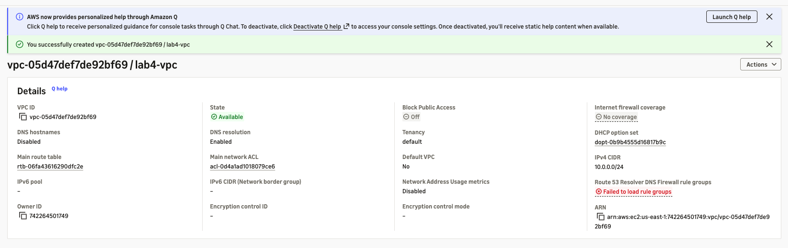

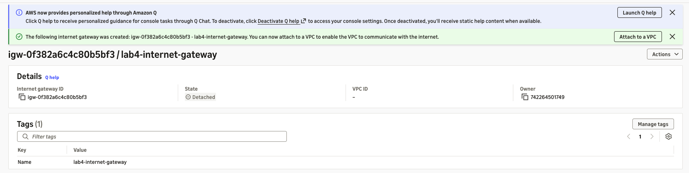

## Public subnet

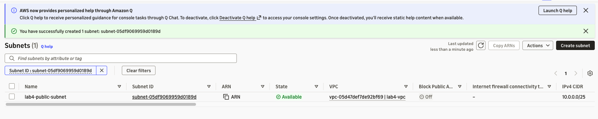

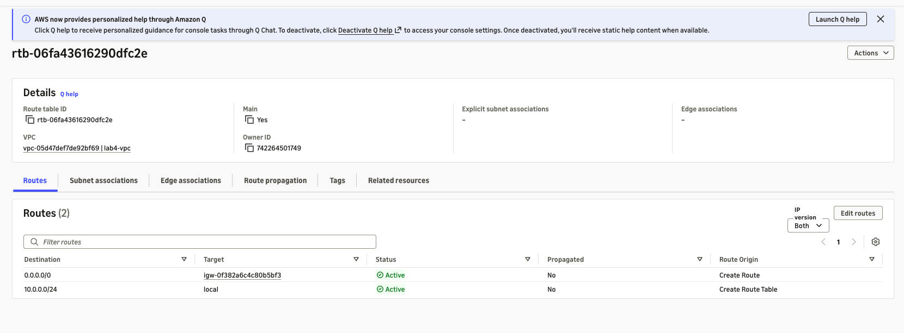

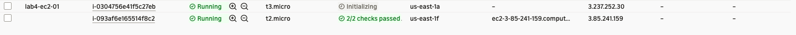

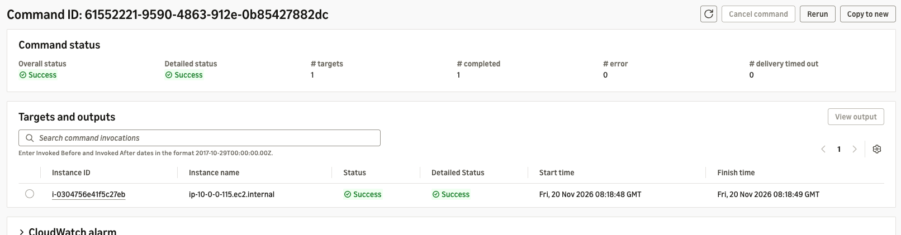

## Private subnet

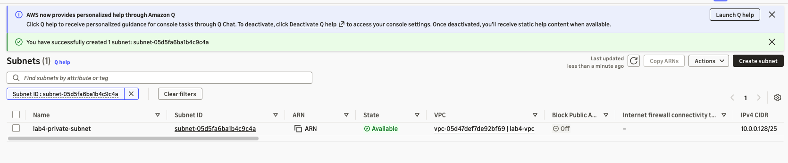

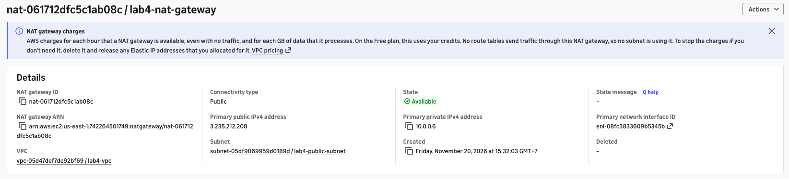

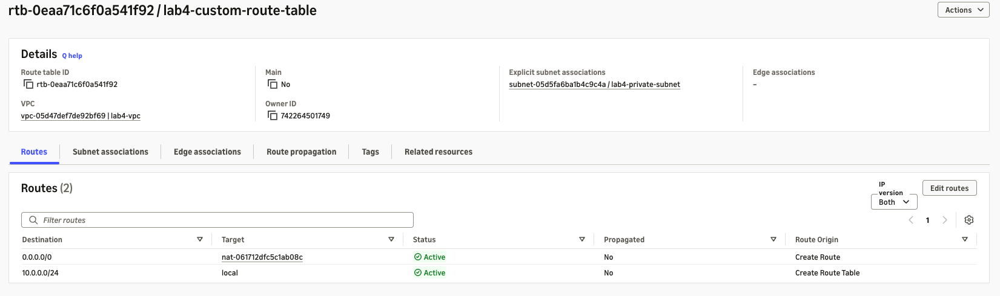

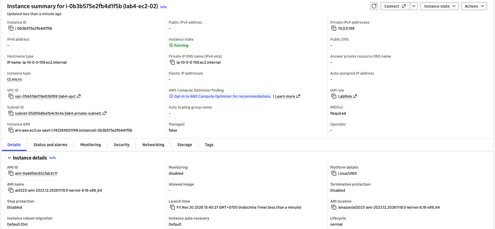

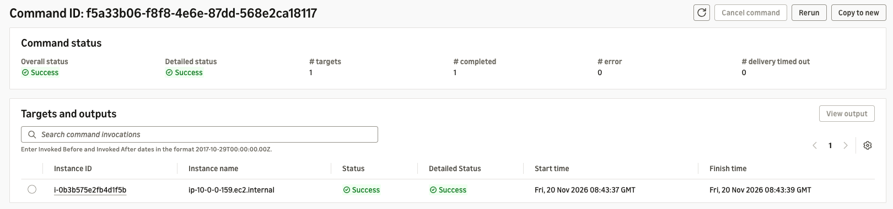

---

## Questions

1. The VPC is `10.0.0.0/24` and the subnets are `10.0.0.0/25` and `10.0.0.128/25`. How many IP addresses does each block contain, and why do the two subnets not overlap?
   - **Number of IP addresses:**
     - The VPC block `10.0.0.0/24` has a 24-bit prefix and 8 host bits ($32 - 24 = 8$), containing $2^8 = \mathbf{256}$ total IPv4 addresses (`10.0.0.0` to `10.0.0.255`).
     - Each subnet (`10.0.0.0/25` and `10.0.0.128/25`) has a 25-bit prefix and 7 host bits ($32 - 25 = 7$), containing $2^7 = \mathbf{128}$ total IPv4 addresses each.
     - *(AWS Reservation Note:)* In any AWS VPC subnet, AWS reserves 5 IP addresses (the network address `.0`, VPC router `.1`, DNS resolver `.2`, future use `.3`, and broadcast address `.127`/`.255`), leaving $\mathbf{123}$ usable addresses for EC2 instances and network interfaces in each subnet.
   - **Why the two subnets do not overlap:**
     - Subnetting a `/24` into two `/25` subnets divides the block by the most significant host bit (the 25th bit in the 4th octet):
       - `10.0.0.0/25`: The 25th bit is `0` (`00000000_2` to `01111111_2`), spanning IP addresses `10.0.0.0` through `10.0.0.127`.
       - `10.0.0.128/25`: The 25th bit is `1` (`10000000_2` to `11111111_2`), spanning IP addresses `10.0.0.128` through `10.0.0.255`.
     - Because the 25th bit is mutually exclusive (`0` vs `1`), no single IPv4 address can belong to both subnets. They cleanly partition the entire `/24` address space into two distinct, non-overlapping halves.

2. Both subnets are in the same VPC. What exactly makes `lab4-public-subnet` public and `lab4-private-subnet` private?
   - In AWS VPC networking, subnets are identical in architecture; their classification as **public** or **private** is determined by their **associated route table** and whether instances inside them can be reached directly from the internet:
     - **`lab4-public-subnet` is public because:** Its associated route table (`rtb-06fa43616290dfc2e`) has a default route (`0.0.0.0/0`) targeting an **Internet Gateway (IGW)** (`igw-0f382a6c4c80b5bf3`). Instances placed in this subnet that possess a public IPv4 address (e.g., `lab4-ec2-01` with `3.237.252.30`) can both initiate connections to and receive direct incoming connections from the public internet.
     - **`lab4-private-subnet` is private because:** Its route table (`rtb-0eaa71c6f0a541f92 / lab4-custom-route-table`) does **not** route traffic to an Internet Gateway. Instead, its default route (`0.0.0.0/0`) directs outbound traffic to a **NAT Gateway** (`nat-061712dfc5c1ab08c`). Instances in this subnet (e.g., `lab4-ec2-02`) have only private IPv4 addresses (`10.0.0.159`) and cannot be directly addressed or reached from the outside internet.

3. Why is the NAT gateway placed in the **public** subnet and not in the private one?
   - A NAT Gateway acts as an outbound translation proxy for private instances. To fulfill this purpose, the NAT Gateway itself must have direct two-way access to the internet through the Internet Gateway:
     1. It must reside in a subnet that has a route table entry sending default traffic (`0.0.0.0/0`) to the **Internet Gateway** (which defines a public subnet).
     2. It must have a public **Elastic IP (EIP)** assigned to its network interface so external internet servers can reply back to it.
   - If the NAT Gateway were placed inside the **private subnet**, it would have no route to an Internet Gateway. Consequently, the NAT Gateway itself would be unable to communicate with the internet, making it impossible to forward or translate traffic on behalf of instances in the private subnet.

4. `lab4-ec2-02` has no public IP address. Can someone on the internet open a connection to it? Can it download updates? Explain both answers.
   - **Can someone on the internet open a connection to it? No.**
     - `lab4-ec2-02` only has a private IPv4 address (`10.0.0.159`), which is non-routable over the public internet (RFC 1918).
     - Furthermore, the NAT Gateway only performs **one-way Source NAT (SNAT)** for outbound traffic initiated from within the VPC; it does not perform Destination NAT (DNAT) or port forwarding for incoming connections initiated from the outside internet.
     - With no public IP, no route to an Internet Gateway in its route table, and no DNAT mapping, external internet hosts cannot route packets to or establish connections with `lab4-ec2-02`.
   - **Can it download updates? Yes.**
     - When `lab4-ec2-02` initiates an outbound connection (e.g., running `dnf update` or `curl`), its traffic is directed by the private route table (`0.0.0.0/0 -> nat-061712dfc5c1ab08c`) to the NAT Gateway in the public subnet.
     - The NAT Gateway substitutes the private IP (`10.0.0.159`) with its public Elastic IP (`3.235.212.208`), sends the request out through the Internet Gateway, and tracks the connection in its internal state table.
     - When the external update server responds, the NAT Gateway translates the destination IP back to `10.0.0.159` and forwards the response packets back to `lab4-ec2-02`.

5. You tested internet access with Systems Manager instead of SSH. Why did the instances need `LabInstanceProfile` for this?
   - AWS Systems Manager (SSM) does not use SSH keys or listen on inbound ports like port 22. Instead, it relies on the **Amazon SSM Agent** running locally on the instance to initiate outbound HTTPS (port 443) connections to the AWS Systems Manager service endpoints.
   - In order for the SSM Agent to authenticate with the Systems Manager service APIs, register the EC2 instance as a managed node, and receive/execute commands securely, it requires valid AWS IAM credentials.
   - The **`LabInstanceProfile`** provides the EC2 instance with the **`LabRole`** IAM role (which carries managed policies such as `AmazonSSMManagedInstanceCore`).
   - The instance fetches these temporary credentials via the EC2 Instance Metadata Service (IMDS). Without `LabInstanceProfile`, the SSM Agent cannot authenticate, preventing AWS Systems Manager from discovering the instance or executing Run Command / Session Manager tasks on it.

## Problems and how I solved them (optional)

- **NAT Gateway Initialization Latency:** When creating `lab4-nat-gateway`, the gateway remained in the `Pending` state for several minutes before transitioning to `Available`. Routing traffic to it before it became available would cause connection timeouts. I resolved this by monitoring the status in the VPC console and only updating `lab4-custom-route-table` once the NAT Gateway was fully in the `Available` state with its Elastic IP (`3.235.212.208`) mapped.
- **SSM Agent Registration Delay on Private Subnet Instance:** Initially, `lab4-ec2-02` did not immediately appear in the Systems Manager Run Command target list. Because the instance has no public IP, the SSM Agent required the private route table's `0.0.0.0/0` route to the NAT Gateway to be active in order to reach the Systems Manager endpoints over outbound HTTPS. Once the route table association and NAT route were verified, the instance registered and the test command completed with status `Success`.

## AI note (optional)

One suggestion an AI tool gave you and how you checked it.
- **AI suggestion:** An AI tool suggested checking whether any inbound rules were required on the private instance's security group to allow response packets back from the internet during yum/dnf updates.
- **How I checked it:** I verified this against AWS documentation on security groups: AWS Security Groups are stateful. When an instance initiates an outbound connection, response traffic for that connection is automatically tracked and allowed back in, regardless of inbound security group rules. I verified this in practice by observing that `lab4-ec2-02` had no inbound rules open to the internet yet successfully downloaded and executed commands via Systems Manager and the NAT Gateway.

## Clean up

- [x] Instances terminated.
- [x] NAT gateway deleted and its Elastic IP released.
- [x] Internet gateway detached and deleted.
- [x] `lab4-vpc` deleted.
