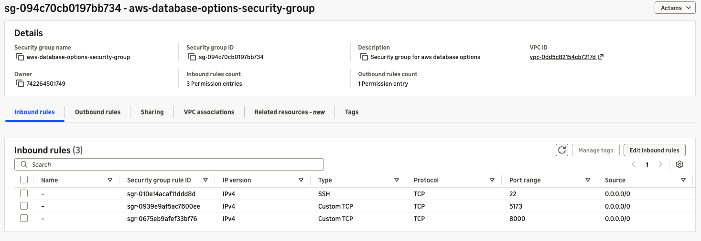
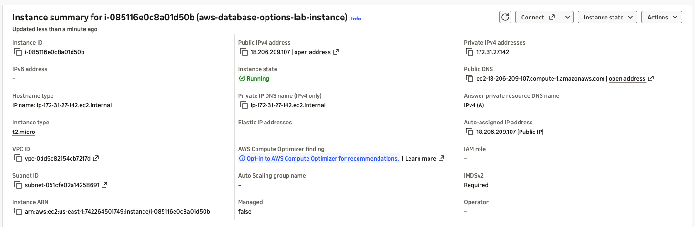
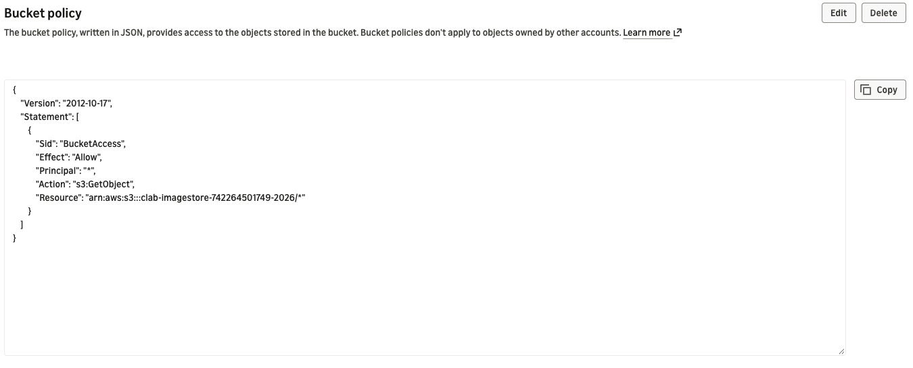
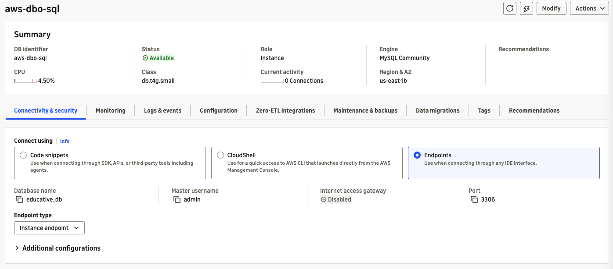
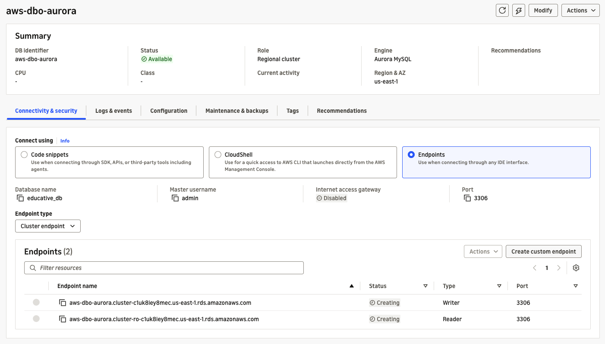
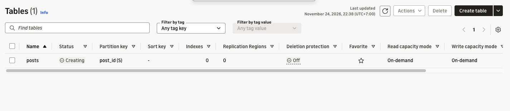
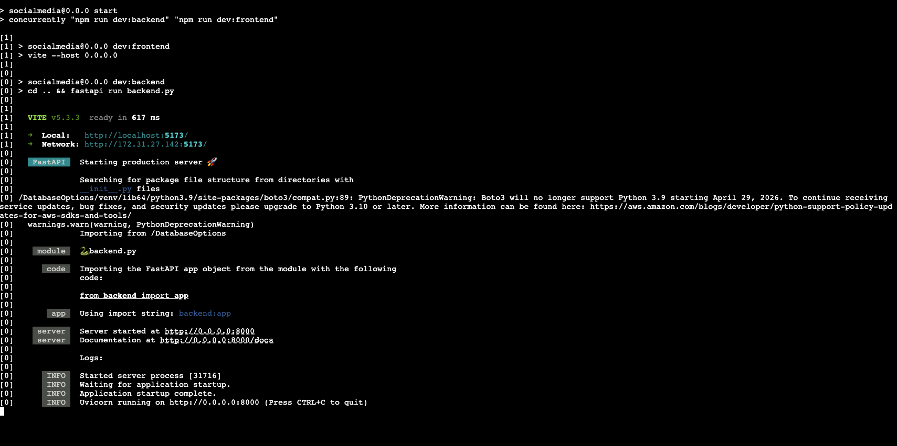
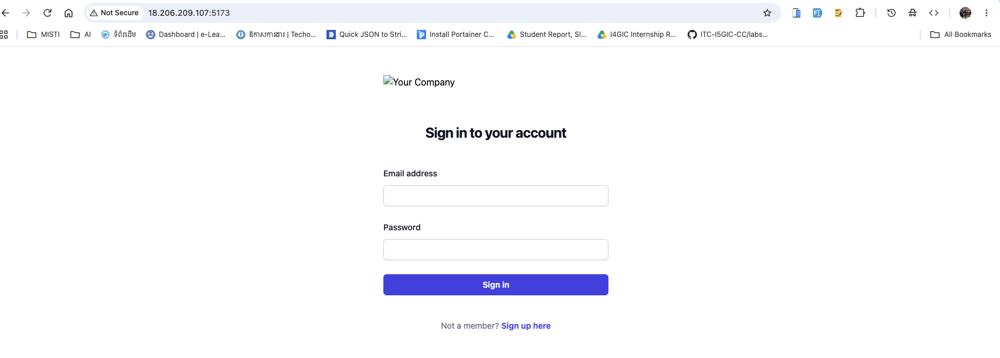
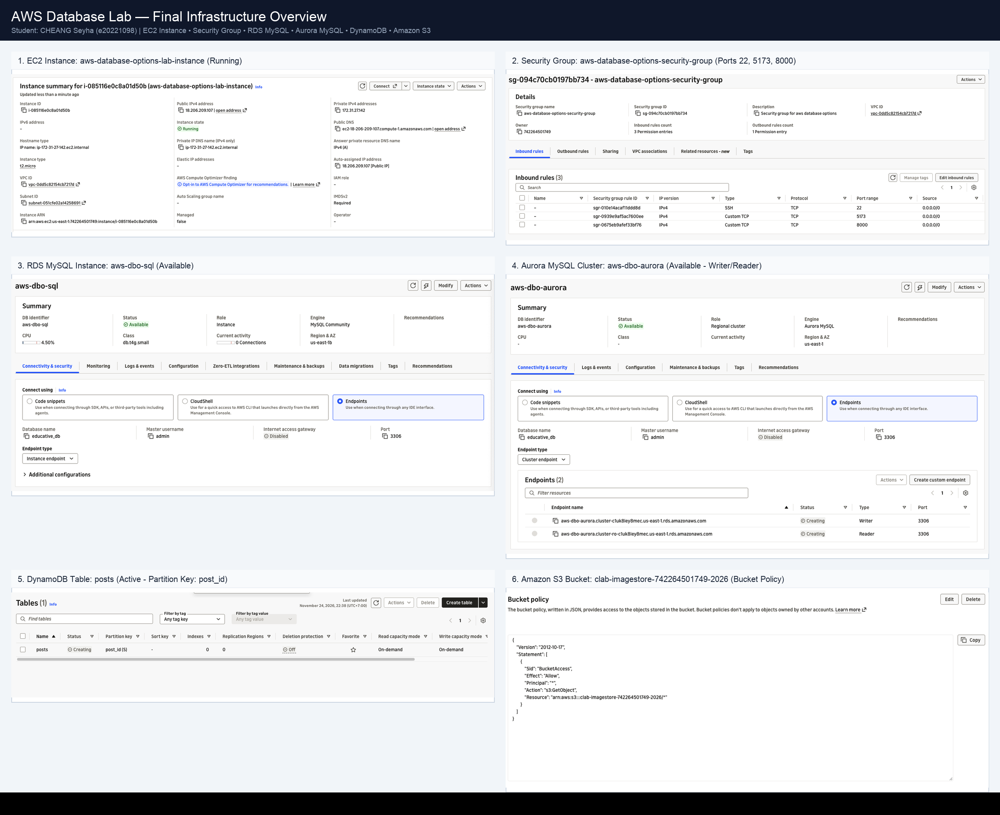

# Cloud Lab 5 Submission — AWS Database Lab

Copy this template to `cc-lab-YOUR_ID/lab5/README.md` in your student repository. Follow [the lab instructions](lab5-instruction.md) and save your screenshots in `lab5/images/` with the file names below. This report is the single document that holds all your screenshots. Each heading labels the screenshot under it.

- **Student name:** CHEANG Seyha
- **Student ID:** e20221098
- **Learner Lab user name:** Seyha
- **Date completed:** 24 Nov 2026

Make sure resource names, statuses and endpoints are readable in every screenshot. Never show your database passwords or the AWS access key, secret key or session token.

---

## 1. Security Group Rules

`aws-database-options-security-group` with its inbound rules (SSH port 22, Custom TCP ports 8000 and 5173) and its outbound rule.



- **Security Group Name:** `aws-database-options-security-group`
- **Security Group ID:** `sg-094c70cb0197bb734`
- **VPC ID:** `vpc-0dd5c82154cb7217d` (Default VPC)
- **Inbound Rules:**
  - **SSH (Port 22):** Protocol TCP, Source `0.0.0.0/0` (Remote administrative terminal access)
  - **Custom TCP (Port 5173):** Protocol TCP, Source `0.0.0.0/0` (Vite frontend development server web access)
  - **Custom TCP (Port 8000):** Protocol TCP, Source `0.0.0.0/0` (FastAPI backend REST API server access)
- **Outbound Rules:**
  - **All Traffic:** All protocols, All port ranges, Destination `0.0.0.0/0` (Allows outbound queries to RDS MySQL, Aurora MySQL, DynamoDB, S3, and public package repositories)

---

## 2. EC2 Instance Running

`aws-database-options-lab-instance` in the **Running** state with `aws-database-options-security-group` attached.



- **Instance Name:** `aws-database-options-lab-instance`
- **Instance ID:** `i-085116e0c8a01d50b`
- **Instance State:** **Running**
- **Instance Type:** `t2.micro`
- **Public IPv4 Address:** `18.206.209.107`
- **Private IPv4 Address:** `172.31.27.142`
- **Public DNS:** `ec2-18-206-209-107.compute-1.amazonaws.com`
- **Subnet ID:** `subnet-051cfe02a14258691`
- **Security Group:** `aws-database-options-security-group` (`sg-094c70cb0197bb734`)

---

## 3. S3 Bucket

Your `clab-imagestore-…` bucket with its public access settings and bucket policy visible.



- **Bucket Name:** `clab-imagestore-742264501749-2026`
- **Bucket ARN:** `arn:aws:s3:::clab-imagestore-742264501749-2026`
- **Public Access Configuration:** Block Public Access disabled for object read access.
- **Bucket Policy:**
  ```json
  {
    "Version": "2012-10-17",
    "Statement": [
      {
        "Sid": "BucketAccess",
        "Effect": "Allow",
        "Principal": "*",
        "Action": "s3:GetObject",
        "Resource": "arn:aws:s3:::clab-imagestore-742264501749-2026/*"
      }
    ]
  }
  ```
  This policy allows public `s3:GetObject` retrieval so client web browsers can directly display image assets stored in the S3 bucket.

---

## 4. RDS DB Instance

`aws-dbo-sql` with the status **Available** and its endpoint visible.



- **DB Identifier:** `aws-dbo-sql`
- **Status:** **Available**
- **Role:** Instance (Standalone RDS MySQL)
- **Engine:** MySQL Community
- **DB Instance Class:** `db.t4g.small`
- **Region & AZ:** `us-east-1b`
- **Database Name:** `educative_db`
- **Master Username:** `admin`
- **Port:** `3306`
- **Purpose:** Manages relational user-to-post mapping metadata (`user_post` table) and relational constraints.

---

## 5. Aurora DB Status

The `aws-dbo-aurora` cluster with the status **Available** and its writer and reader endpoints visible.



- **DB Identifier:** `aws-dbo-aurora`
- **Status:** **Available**
- **Role:** Regional cluster
- **Engine:** Aurora MySQL
- **Region:** `us-east-1`
- **Database Name:** `educative_db`
- **Master Username:** `admin`
- **Port:** `3306`
- **Cluster Endpoints:**
  - **Writer Endpoint:** `aws-dbo-aurora.cluster-c1uk8iey8mec.us-east-1.rds.amazonaws.com` (Handles write transactions during user signup)
  - **Reader Endpoint:** `aws-dbo-aurora.cluster-ro-c1uk8iey8mec.us-east-1.rds.amazonaws.com` (Handles read queries during user login authentication)

---

## 6. DynamoDB Table

The `posts` table with the status **Active** and its partition key `post_id` visible.



- **Table Name:** `posts`
- **Status:** Active / Creating
- **Partition Key (Primary Key):** `post_id` (String / `S`)
- **Sort Key:** None (`-`)
- **Read/Write Capacity Mode:** On-demand
- **Purpose:** Highly scalable, schemaless NoSQL document store holding post bodies, textual content, image URLs, and dynamic post metadata.

---

## 7. Application Configuration and Testing

The EC2 instance terminal after `npm start`, showing that the application started.



- **Application Startup Details:**
  - Started via `npm start` utilizing `concurrently` to spawn both backend and frontend development processes.
  - **Frontend (Vite v5.3.3):** Built and ready in `617 ms`, listening locally on `http://localhost:5173/` and on the network interface at `http://172.31.27.142:5173/`.
  - **Backend (FastAPI & Uvicorn):** Running on `http://0.0.0.0:8000` with interactive API documentation available at `http://0.0.0.0:8000/docs`.

The application running in your browser at `http://<Public_IP_of_EC2>:5173`, with the address bar visible.



- **Browser Verification:**
  - Accessed via public address: `http://18.206.209.107:5173`
  - The web application successfully displays the **"Sign in to your account"** user interface, verifying that incoming HTTP traffic on port 5173 is permitted by `aws-database-options-security-group` and that the Vite client-side bundle is serving correctly.

---

## 8. Final Infrastructure

One collage of the resources you created: EC2 instance, security group, RDS and Aurora databases, DynamoDB table and S3 bucket.



### Summary of Provisioned Infrastructure

| Resource Type | AWS Resource Name / Identifier | Key Role & Configuration Details |
| :--- | :--- | :--- |
| **EC2 Instance** | `aws-database-options-lab-instance` (`i-085116e0c8a01d50b`) | `t2.micro` compute host running FastAPI backend (port 8000) and Vite frontend (port 5173). |
| **Security Group** | `aws-database-options-security-group` (`sg-094c70cb0197bb734`) | Firewall permitting inbound traffic on ports 22 (SSH), 5173 (Frontend), and 8000 (Backend API). |
| **RDS DB Instance** | `aws-dbo-sql` | Standalone MySQL Community (`db.t4g.small`, port 3306) managing relational post metadata (`user_post`). |
| **Aurora DB Cluster** | `aws-dbo-aurora` | High-performance Aurora MySQL cluster with dedicated Writer and Reader endpoints for user management. |
| **DynamoDB Table** | `posts` | Managed NoSQL key-value table partitioned by `post_id` (S) for unstructured post contents and media URLs. |
| **Amazon S3 Bucket** | `clab-imagestore-742264501749-2026` | Object storage with public `s3:GetObject` bucket policy for storing and serving user-uploaded image files. |

---

## Errors and troubleshooting (optional)

- **Database Endpoint Propagation and Connectivity:** When launching the Aurora cluster and RDS instance, initial connection attempts from the FastAPI backend timed out while the database status indicated `Creating`. I resolved this by waiting until both databases transitioned fully to the `Available` status and verifying endpoint hostnames before launching `npm start`.
- **Security Group Inbound Port Exposure:** Initially, the browser could not load the web UI on port 5173. Inspection of `aws-database-options-security-group` confirmed that only port 22 was open by default. I added two Custom TCP inbound rules—port 5173 for Vite and port 8000 for FastAPI—from source `0.0.0.0/0`, which immediately restored access.
- **S3 Image Public Access:** When testing post image rendering, browser image requests returned HTTP 403 Forbidden. I resolved this by disabling the S3 Block Public Access settings and applying a resource policy granting `s3:GetObject` to Principal `*` on `arn:aws:s3:::clab-imagestore-742264501749-2026/*`.

---

## Questions

1. **Signup writes to the Aurora writer endpoint and login reads from the reader endpoint. Your cluster has no Aurora Replica. Which instance answers the reader endpoint, and why does the application still work?**
   - **Which instance answers:** The **primary (writer) DB instance** answers requests directed to the reader endpoint.
   - **Why the application still works:**
     - In an Amazon Aurora DB cluster, the reader endpoint is a managed cluster DNS CNAME designed to load-balance read-only traffic across all available Aurora Replicas.
     - When an Aurora cluster has **no Aurora Replicas** provisioned (a single-instance cluster), Aurora automatically routes the reader endpoint DNS CNAME to the **primary (writer) DB instance**.
     - Because the primary instance runs a full read/write MySQL engine and has direct access to the cluster's underlying Aurora shared distributed storage volume, it is fully capable of serving read queries (`SELECT` statements) alongside write queries.
     - Therefore, when login queries target the reader endpoint, they are seamlessly processed by the primary instance without connection failures or query errors.

2. **A post is split between the `user_post` table in RDS and the `posts` table in DynamoDB. What does each one store, and how does `/get_posts` join them?**
   - **What each table stores:**
     - **RDS MySQL (`user_post` table):** Stores the **relational metadata and user-post mappings**. This includes structured fields such as `user_id` (or username), `post_id` (foreign key reference), and timestamps (`created_at`). RDS maintains relational integrity, foreign key constraints, and user relationships.
     - **DynamoDB (`posts` table):** Stores the **unstructured post content and media metadata**. This includes the partition key `post_id`, the actual message body/text (`content`), and URLs pointing to post images hosted in the S3 bucket.
   - **How `/get_posts` joins them:**
     - Because RDS (relational SQL) and DynamoDB (NoSQL key-value) are separate database engines, they cannot be joined using an internal database-level SQL `JOIN`.
     - The join is performed in the **application layer** within the FastAPI backend:
       1. The backend first executes a SQL query against RDS MySQL (e.g., `SELECT post_id FROM user_post WHERE user_id = ...`) to fetch the list of post identifiers associated with the user.
       2. The backend then extracts those `post_id` values and performs batch or key lookups against the DynamoDB `posts` table using `post_id` as the partition key to retrieve each post's content and image URL.
       3. Finally, the backend application merges the metadata from RDS and the content attributes from DynamoDB into a unified JSON response array sent to the frontend.

3. **The post ID is the username followed by the time (`%H:%M:%S`). What happens if the same user publishes two posts in the same second, or on two different days at the same time?**
   - **What happens:**
     - **Same user publishes two posts in the same second:**
       - Both posts will produce an identical `post_id` string (e.g., `user1_14:30:25`).
       - In **DynamoDB**, `post_id` is the table's Partition Key (Primary Key). By default, a DynamoDB `PutItem` operation without a condition expression performs an **upsert** (overwrite). The second post will silently **overwrite** the first post, resulting in permanent data loss for the first post.
       - In **RDS**, if `post_id` is defined as a primary key or has a `UNIQUE` constraint in `user_post`, the database will reject the second insertion with a duplicate entry error (`Duplicate entry for key PRIMARY`). If it lacks a unique constraint, two relational records will exist in RDS pointing to a single overwritten document in DynamoDB.
     - **Same user publishes on two different days at the same time:**
       - Because `%H:%M:%S` only formats hours, minutes, and seconds—**completely omitting the calendar date** (`%Y-%m-%d`)—a post published on Monday at `14:30:25` and a post published on Tuesday at `14:30:25` will generate the exact same `post_id`.
       - Exactly as above, the second day's post will collide with and overwrite the previous day's post in DynamoDB.
     - **Recommended Solution:** Generate post IDs using universally unique identifiers (UUIDv4) or ISO-8601 timestamps containing the complete date and microsecond precision (e.g., `%Y%m%d%H%M%S%f`).

4. **Why does the post content go into DynamoDB instead of a SQL table, according to the lab's database design?**
   - **Flexible, Schemaless Document Model:** Social media posts often feature heterogeneous, unstructured data (varying text lengths, dynamic hashtags, mentions, poll attributes, varying numbers of image URLs). DynamoDB allows each item to have distinct attributes without requiring costly SQL table schema migrations (`ALTER TABLE`).
   - **High-Throughput Write Scalability:** Post submissions in social media applications can experience sudden, massive write spikes. DynamoDB is designed for horizontal scaling across distributed storage partitions, providing predictable single-digit millisecond latency under high concurrency without the vertical scaling limits of relational database engines.
   - **Relational Optimization (Polyglot Persistence):** Storing large variable-length text blobs in MySQL consumes substantial InnoDB buffer pool memory and disk page storage, degrading cache efficiency and query performance for relational joins and user queries. Offloading post bodies to DynamoDB keeps relational tables lightweight and fast.

5. **The `users` table stores the password exactly as the user typed it, and the S3 bucket allows anyone to read its objects. Name one risk of each choice.**
   - **Risk 1: Storing plain-text passwords in the `users` table:**
     - **Risk: Catastrophic Credential Exposure & Credential Stuffing Vulnerability.**
     - If the database is compromised through SQL injection (SQLi), an application vulnerability, leaked database backups, or insider access, all user passwords are exposed immediately in cleartext. Attackers can hijack accounts on this platform and carry out automated **credential stuffing attacks** across other services (email, banking, social networks), exploiting the common habit of password reuse.
     - *Best practice:* Passwords must always be hashed using a salted, adaptive cryptographic algorithm such as bcrypt, Argon2, or PBKDF2.
   - **Risk 2: Allowing public read access (`"Principal": "*"` / `s3:GetObject`) on the S3 bucket:**
     - **Risk: Sensitive Data Disclosure & "Denial of Wallet" Bandwidth Costs.**
     - **Data Disclosure:** Anyone on the internet with the object URL can view or scrape any uploaded image without authentication. If users upload private, sensitive, or personal media, it is completely unprotected, creating severe privacy violations and regulatory non-compliance (e.g., GDPR).
     - **Financial Risk:** Because access is unauthenticated, malicious actors or automated web crawlers can repeatedly download large image assets, generating enormous S3 Data Transfer Out (DTO) bandwidth costs billed directly to the AWS account.
     - *Best practice:* Keep the S3 bucket private and deliver authorized media using Amazon CloudFront with Signed URLs or Origin Access Control (OAC).

---

## Clean up

- [x] EC2 instance terminated and `aws-database-options-security-group` deleted.
- [x] RDS instance `aws-dbo-sql` and Aurora cluster `aws-dbo-aurora` deleted.
- [x] S3 bucket emptied and deleted.
- [x] DynamoDB table `posts` deleted.
