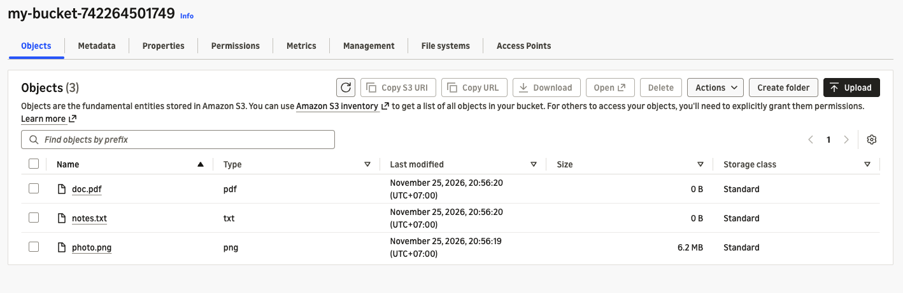
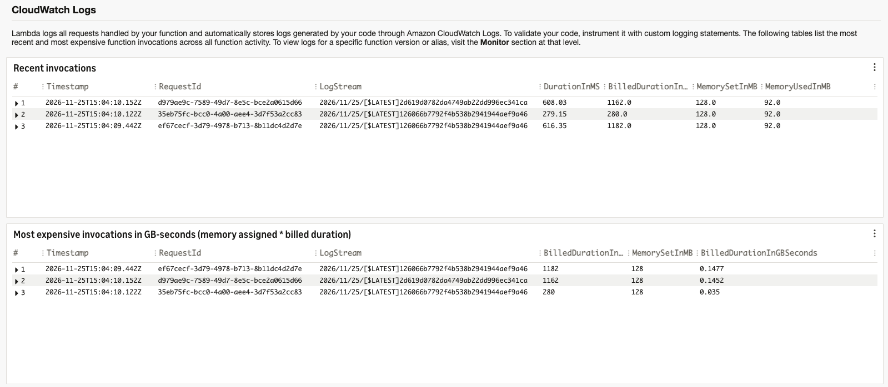

# Cloud Lab 6 Submission — S3 Events with AWS Lambda

Copy this template to `cc-lab-YOUR_ID/lab6/README.md` in your own repository. Follow [the instructions](lab6-instruction.md). Put your screenshots in `lab6/images/` and your function code in `lab6/lambda_function.py`.

- **Student name:** CHEANG Seyha
- **Student ID:** e20221098
- **Learner Lab user name:** Seyha
- **Bucket name:** `my-bucket-742264501749`
- **Date completed:** 25 Nov 2026

---

## Files sorted by type

Which files did you upload, and which folders did the function create?

- **Uploaded files:**
  - `doc.pdf`
  - `notes.txt`
  - `photo.png`
- **Folders (prefixes) created by the Lambda function:**
  - `pdf/` (containing `pdf/doc.pdf`)
  - `txt/` (containing `txt/notes.txt`)
  - `png/` (containing `png/photo.png`)

## CloudWatch logs

- **Invocation & Log Details:**
  - Uploading the three files (`doc.pdf`, `notes.txt`, and `photo.png`) triggered three asynchronous Lambda invocations (`ef67cecf-3d79-4978-b713-8b11dc4d2d7e`, `35eb75fc-bcc0-4a00-aee4-3d7f53a2cc83`, and `d979ae9c-7589-49d7-8e5c-bce2a0615d66`) with `128 MB` configured memory (`92 MB` used).
  - After moving each uploaded object into its corresponding extension folder, the function lists the bucket prefixes and logs the file counts to CloudWatch Logs (`We have 1 pdf file(s).`, `We have 1 txt file(s).`, `We have 1 png file(s).`).

## Function code

My function code is in [lambda_function.py](lambda_function.py).

---

## Questions

1. **Describe, step by step, what happens from the moment you click Upload until the log line appears in CloudWatch. Name each AWS service involved.**
   1. **Object Upload (Amazon S3):** Clicking **Upload** in the S3 console sends an HTTP `PUT` request (`PutObject`) to **Amazon S3**, saving the file (e.g., `doc.pdf`) at the root of the bucket `my-bucket-742264501749`.
   2. **Event Notification Trigger (Amazon S3 $\rightarrow$ AWS Lambda):** Once the object is stored, **Amazon S3** matches the upload against its configured Event Notification rule (`s3:ObjectCreated:Put`) and asynchronously invokes **AWS Lambda** (permitted by the Lambda function's resource-based policy), passing a JSON event payload containing the bucket name and object key.
   3. **Environment Initialization & Authorization (AWS Lambda & AWS IAM):** **AWS Lambda** provisions an isolated microVM execution environment (or reuses a warm one) running the Python runtime and assumes the `LabRole` execution role via **AWS Identity and Access Management (IAM)** / AWS STS to obtain temporary credentials.
   4. **File Organization via SDK Calls (AWS Lambda $\leftrightarrow$ Amazon S3):** Lambda runs `lambda_handler(event, context)` in `lambda_function.py`. Using `boto3` (authenticated as `LabRole`), the function extracts the file extension (`pdf`, `txt`, or `png`), calls `s3.copy_object()` on **Amazon S3** to copy the file into its type prefix (e.g., `pdf/doc.pdf`), calls `s3.delete_object()` to remove the original file at the root, and calls `s3.list_objects_v2()` to count the files inside each folder prefix.
   5. **Log Delivery (AWS Lambda $\rightarrow$ Amazon CloudWatch Logs):** When `print('We have {} {} file(s).'.format(...))` runs, the **AWS Lambda** runtime captures standard output (`stdout`) along with the `START`, `END`, and `REPORT` lines and uses `LabRole` permissions to write the log events to a log stream under `/aws/lambda/<function-name>` in **Amazon CloudWatch Logs**, where the log line becomes visible.

2. **Why was the trigger limited to PUT events? What would happen with All object create events?**
   - **Why it was limited to `PUT` events (`s3:ObjectCreated:Put`):**
     - Uploading a file directly from the console generates an `s3:ObjectCreated:Put` (`PUT`) event.
     - Inside `lambda_function.py`, moving the file into its folder calls `s3.copy_object(...)` to create a new object in the **same bucket** (`my-bucket-742264501749`), which generates an `s3:ObjectCreated:Copy` (`COPY`) event rather than a `PUT` event.
     - Restricting the trigger to **PUT** ensures that only user uploads invoke the function, while the `copy_object` call made by the function itself does not re-trigger it.
   - **What would happen with `All object create events` (`s3:ObjectCreated:*`):**
     - **All object create events** triggers on `Put`, `Post`, `Copy`, and `CompleteMultipartUpload`.
     - Because `s3.copy_object()` writes the sorted object back into the **same S3 bucket**, S3 emits an `s3:ObjectCreated:Copy` event that **re-triggers the Lambda function** on the newly copied object (e.g., `pdf/doc.pdf`).
     - In general S3-to-same-bucket designs, this causes a **recursive invocation loop** (S3 triggers Lambda $\rightarrow$ Lambda writes to S3 $\rightarrow$ S3 triggers Lambda again), wasting concurrency and causing runaway Lambda and S3 request charges until AWS Lambda's recursive loop detection halts it.
     - Furthermore, in our specific `lambda_function.py`, when re-triggered on `pdf/doc.pdf`, `new_s3_key` resolves to `pdf/doc.pdf` (the exact same key as `s3_key`). Calling `s3.copy_object()` from `pdf/doc.pdf` onto itself without modifying metadata raises an S3 `InvalidRequest` error (causing automatic Lambda retries), or—if the copy succeeded—the next line `s3.delete_object(Bucket=s3_bucket, Key=s3_key)` would delete `pdf/doc.pdf` itself!

3. **The function uses `LabRole`. Which two permissions does this role need for the function to work?**
   - `LabRole` needs permissions for **two AWS services**:
     1. **Amazon S3 Permissions (to move and count objects in the bucket):**
        - *Managed policy equivalent:* `AmazonS3FullAccess` (or a least-privilege bucket policy).
        - *Specific IAM actions required:* `s3:GetObject` and `s3:PutObject` (for `s3.copy_object()` to read the original object and write the new key), `s3:DeleteObject` (for `s3.delete_object()` to remove the root object), and `s3:ListBucket` (for `s3.list_objects_v2()` to list folders and count files).
     2. **Amazon CloudWatch Logs Permissions (to record function output and execution logs):**
        - *Managed policy equivalent:* `AWSLambdaBasicExecutionRole`.
        - *Specific IAM actions required:* `logs:CreateLogGroup`, `logs:CreateLogStream`, and `logs:PutLogEvents` so Lambda can create log streams and publish `print()` output to CloudWatch Logs.

4. **You never started or stopped a server in this lab. Who runs your code, and what do you pay for?**
   - **Who runs your code:** **AWS (specifically the AWS Lambda serverless service)** runs the code. AWS provisions, patches, scales, and manages the underlying servers, Firecracker microVMs, operating system, and Python runtime environment automatically on demand whenever an S3 event arrives, and scales down to zero when idle.
   - **What you pay for:** You pay **nothing for idle server time**. Under AWS Lambda's pay-per-use model, you only pay for:
     1. **Number of requests (invocations):** Billed per million function invocations triggered by events (after the AWS Free Tier of 1 million requests per month).
     2. **Compute duration (GB-seconds):** Calculated by multiplying the **configured memory** (e.g., `128 MB` = `0.125 GB`) by the **billed execution time in milliseconds** (rounded up to the nearest `1 ms`, including initialization duration on cold starts, after the Free Tier of 400,000 GB-seconds per month).
     *(Standard per-use charges also apply to Amazon S3 storage/API requests and Amazon CloudWatch Logs storage outside their respective free tiers.)*

## Problems and how I solved them (optional)

- **Asynchronous S3 Console View Refresh:** Right after uploading `doc.pdf`, `notes.txt`, and `photo.png`, the S3 Console initially still showed the uploaded objects at the root level because S3 Event Notifications invoke AWS Lambda asynchronously in the background. Clicking the S3 bucket **Refresh** button after a moment confirmed whether the trigger executed and moved the files into `pdf/`, `txt/`, and `png/`.
- **Concurrent Invocations on Multi-File Upload:** Uploading all three files at the same time triggered three simultaneous S3 `PUT` events (`15:04:09Z`–`15:04:10Z`), causing AWS Lambda to spin up two separate execution environments (two log streams with cold-start initialization overhead of ~550–565 ms) and reuse one warm environment (`279.15 ms` duration). Inspecting all log streams in CloudWatch Logs confirmed all three invocations completed cleanly.

## AI note (optional)

One suggestion an AI tool gave you and how you checked it.

- **AI suggestion:** An AI tool explained that Amazon S3 does not have a native `move` or `rename` API call because S3 is a flat object storage system with immutable keys rather than a hierarchical POSIX file system, so moving a file into a folder requires calling `s3.copy_object()` followed by `s3.delete_object()`.
- **How I checked it:** I checked the official AWS Boto3 S3 client documentation to confirm there is no `move_object` or `rename_object` method, verified how `CopySource` and `Key` work in [lambda_function.py](lambda_function.py), and confirmed through testing that the original root key is removed after copying to `<extension>/<filename>`.

## Clean up

- [x] Lambda function deleted.
- [x] S3 bucket emptied and deleted.
